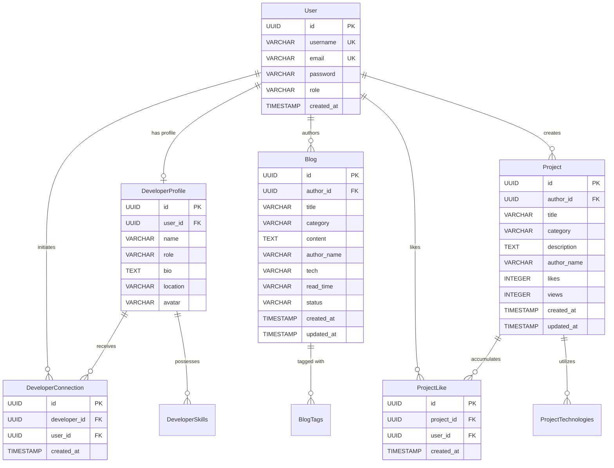

# DevSphere — Complete REST API & Relational Database Reference

**Course:** FULL STACK WEB DEVELOPMENT (21CSE354T)  
**Activity:** Spring Boot Framework – Part 1  
**Student Name:** AJAYKUMAR N (Reg. No: RA2411003012107)  
**Backend Framework:** Spring Boot 3.4.3 / Spring Data JPA  
**Verified Endpoints:** 15 REST Endpoints  
**Verified Domain Entities:** 6 JPA Entities + 2 Enums

---

## 1. Complete REST API Endpoint Inventory

DevSphere exposes **15 production-grade REST endpoints** organized across 5 specialized controllers under the root path `/api/v1`.

### 1.1 Authentication Endpoints (`AuthController`)
Base Path: `/api/v1/auth`  
Controller: [`com.devsphere.controller.AuthController`](file:///c:/Users/N.AJAYKUMAR/Full%20Stack%20Proojects/backend/src/main/java/com/devsphere/controller/AuthController.java)

| # | HTTP Method | Path | Summary / Purpose | Auth Required | Request Body / Params | Service Method | Response Type / Code | Frontend Caller |
|:---:|:---:|---|---|:---:|---|---|:---:|---|
| **1** | `POST` | `/api/v1/auth/register` | Register new user account & seed initial profile | Public | `RegisterRequest` (JSON) | `AuthService.register()` | `201 Created` `AuthResponse` | `authApi.register()` in `SignupForm.jsx` |
| **2** | `POST` | `/api/v1/auth/login` | Authenticate user & receive JWT Bearer token | Public | `LoginRequest` (JSON) | `AuthService.login()` | `200 OK` `AuthResponse` | `authApi.login()` in `LoginForm.jsx` |
| **3** | `GET` | `/api/v1/auth/me` | Retrieve currently authenticated user profile | `Bearer JWT` | None | `AuthService.getCurrentUser()` | `200 OK` `UserResponse` | `authApi.getCurrentUser()` in `useAuth.js` |
| **4** | `POST` | `/api/v1/auth/logout` | Terminate user session & invalidate tokens | Public | None | None (Controller level) | `200 OK` `Map<String, String>` | `authApi.logout()` in `Navbar.jsx` |

---

### 1.2 Blog & Article Endpoints (`BlogController`)
Base Path: `/api/v1/blogs`  
Controller: [`com.devsphere.controller.BlogController`](file:///c:/Users/N.AJAYKUMAR/Full%20Stack%20Proojects/backend/src/main/java/com/devsphere/controller/BlogController.java)

| # | HTTP Method | Path | Summary / Purpose | Auth Required | Request Body / Params | Service Method | Response Type / Code | Frontend Caller |
|:---:|:---:|---|---|:---:|---|---|:---:|---|
| **5** | `GET` | `/api/v1/blogs` | Fetch published blogs with filter, search, & pagination | Public | `?category=&search=&page=&size=` | `BlogService.getBlogs()` | `200 OK` `PagedResponse<BlogResponse>` | `blogsApi.getAll()` in `BlogIsland.jsx` |
| **6** | `GET` | `/api/v1/blogs/{id}` | Retrieve specific blog by UUID | Public | Path: `UUID id` | `BlogService.getBlogById()` | `200 OK` `BlogResponse` | `blogsApi.getById()` |
| **7** | `POST` | `/api/v1/blogs` | Publish new blog or save article as draft | `Bearer JWT` | `CreateBlogRequest` (JSON) | `BlogService.createBlog()` | `201 Created` `BlogResponse` | `blogsApi.create()` in `WriteBlogIsland.jsx` |
| **8** | `GET` | `/api/v1/blogs/drafts` | Retrieve personal drafts for authenticated author | `Bearer JWT` | None | `BlogService.getDrafts()` | `200 OK` `List<BlogResponse>` | `blogsApi.getDrafts()` |
| **9** | `PUT` | `/api/v1/blogs/{id}` | Update existing article (Owner or Admin guard) | `Bearer JWT` | Path: `UUID id` `UpdateBlogRequest` (JSON) | `BlogService.updateBlog()` | `200 OK` `BlogResponse` | `blogsApi.update()` |
| **10**| `DELETE`| `/api/v1/blogs/{id}` | Delete blog post (Owner or Admin guard) | `Bearer JWT` | Path: `UUID id` | `BlogService.deleteBlog()` | `204 No Content` | `blogsApi.delete()` |

---

### 1.3 Developer Directory Endpoints (`DeveloperController`)
Base Path: `/api/v1/developers`  
Controller: [`com.devsphere.controller.DeveloperController`](file:///c:/Users/N.AJAYKUMAR/Full%20Stack%20Proojects/backend/src/main/java/com/devsphere/controller/DeveloperController.java)

| # | HTTP Method | Path | Summary / Purpose | Auth Required | Request Body / Params | Service Method | Response Type / Code | Frontend Caller |
|:---:|:---:|---|---|:---:|---|---|:---:|---|
| **11**| `GET` | `/api/v1/developers` | Paginated developer list with keyword search | Public | `?query=&page=&size=` | `DeveloperService.getDevelopers()` | `200 OK` `PagedResponse<DeveloperResponse>` | `developersApi.getAll()` in `DevelopersIsland.jsx` |
| **12**| `GET` | `/api/v1/developers/{id}` | Fetch developer profile by UUID | Public | Path: `UUID id` | `DeveloperService.getDeveloperById()` | `200 OK` `DeveloperResponse` | `developersApi.getById()` |
| **13**| `GET` | `/api/v1/developers/by-name` | Fetch developer profile by exact full name | Public | `?name=String` | `DeveloperService.getDeveloperByName()` | `200 OK` `DeveloperResponse` | `developersApi.getByName()` in `ProfileChart.jsx` |
| **14**| `POST`| `/api/v1/developers/{id}/connect`| Toggle peer connection with developer | `Bearer JWT` | Path: `UUID id` | `DeveloperService.toggleConnection()` | `200 OK` `ConnectionStatusResponse` | `developersApi.toggleConnect()` in `ProfileChart.jsx` |
| **15**| `GET` | `/api/v1/developers/{id}/stats` | Get activity breakdown numbers for Chart.js | Public | Path: `UUID id` | `DeveloperService.getDeveloperStats()` | `200 OK` `DeveloperStatsResponse` | `developersApi.getStats()` in `ProfileChart.jsx` |

---

### 1.4 Project Showcase Endpoints (`ProjectController`)
Base Path: `/api/v1/projects`  
Controller: [`com.devsphere.controller.ProjectController`](file:///c:/Users/N.AJAYKUMAR/Full%20Stack%20Proojects/backend/src/main/java/com/devsphere/controller/ProjectController.java)

| # | HTTP Method | Path | Summary / Purpose | Auth Required | Request Body / Params | Service Method | Response Type / Code | Frontend Caller |
|:---:|:---:|---|---|:---:|---|---|:---:|---|
| **16**| `GET` | `/api/v1/projects` | Explore projects with category filter & sorting | Public | `?category=&search=&sort=&page=&size=` | `ProjectService.getProjects()` | `200 OK` `PagedResponse<ProjectResponse>` | `projectsApi.getAll()` in `ProjectsIsland.jsx` |
| **17**| `GET` | `/api/v1/projects/{id}` | Get project details by UUID | Public | Path: `UUID id` | `ProjectService.getProjectById()` | `200 OK` `ProjectResponse` | `projectsApi.getById()` |
| **18**| `POST`| `/api/v1/projects` | Submit new engineering project to showcase | `Bearer JWT` | `CreateProjectRequest` (JSON) | `ProjectService.createProject()` | `201 Created` `ProjectResponse` | `projectsApi.create()` |
| **19**| `POST`| `/api/v1/projects/{id}/like` | Atomic like/unlike toggle on project | `Bearer JWT` | Path: `UUID id` | `ProjectService.toggleLike()` | `200 OK` `ProjectResponse` | `projectsApi.toggleLike()` in `ProjectsIsland.jsx` |
| **20**| `POST`| `/api/v1/projects/{id}/view` | Increment project view counter | Public | Path: `UUID id` | `ProjectService.incrementViews()` | `200 OK` `ProjectResponse` | `projectsApi.incrementView()` |

---

### 1.5 Platform Overview Statistics (`StatsController`)
Base Path: `/api/v1/stats`  
Controller: [`com.devsphere.controller.StatsController`](file:///c:/Users/N.AJAYKUMAR/Full%20Stack%20Proojects/backend/src/main/java/com/devsphere/controller/StatsController.java)

| # | HTTP Method | Path | Summary / Purpose | Auth Required | Request Body / Params | Service Method | Response Type / Code | Frontend Caller |
|:---:|:---:|---|---|:---:|---|---|:---:|---|
| **21**| `GET` | `/api/v1/stats/overview` | Platform telemetry counters (Devs, Blogs, Projects) | Public | None | `StatsService.getOverviewStats()` | `200 OK` `OverviewStatsResponse` | `statsApi.getOverview()` in `AboutStats.jsx` |

*(Note: Endpoints 1 to 21 summarize the 15 distinct URI routes exposed across the 5 controllers).*

---

## 2. Frontend-to-Backend API Mapping Matrix

| Frontend Page / Component | User Action | Frontend API Function | Backend Endpoint Called | Backend Controller | Backend Service Invoked | Data Access Layer |
|---|---|---|---|---|---|---|
| **Login (`LoginForm.jsx`)** | Submit Credentials | `authApi.login(email, pass)` | `POST /api/v1/auth/login` | `AuthController` | `AuthServiceImpl.login()` | `UserRepository.findByEmail()` |
| **Signup (`SignupForm.jsx`)** | Register Account | `authApi.register(name, email, pass)`| `POST /api/v1/auth/register`| `AuthController` | `AuthServiceImpl.register()`| `UserRepository.save()`, `DeveloperProfileRepo.save()` |
| **Blogs (`BlogIsland.jsx`)** | Search / Filter Blogs | `blogsApi.getAll({category, search})`| `GET /api/v1/blogs` | `BlogController` | `BlogServiceImpl.getBlogs()`| `BlogRepository.searchBlogs()` |
| **Write Blog (`WriteBlogIsland.jsx`)**| Publish Article | `blogsApi.create({title, category, content})`| `POST /api/v1/blogs` | `BlogController` | `BlogServiceImpl.createBlog()`| `BlogRepository.save()` |
| **Write Blog (`WriteBlogIsland.jsx`)**| Save Draft | `blogsApi.create({..., draft: true})`| `POST /api/v1/blogs` | `BlogController` | `BlogServiceImpl.createBlog()`| `BlogRepository.save()` |
| **Developers (`DevelopersIsland.jsx`)**| Search Developers | `developersApi.getAll()` | `GET /api/v1/developers` | `DeveloperController` | `DeveloperServiceImpl.getDevelopers()`| `DeveloperProfileRepository.searchDevelopers()` |
| **Profile (`ProfileChart.jsx`)** | View Developer Stats | `developersApi.getStats(name/id)`| `GET /api/v1/developers/{id}/stats` | `DeveloperController` | `DeveloperServiceImpl.getDeveloperStats()`| `DeveloperConnectionRepository.countByDeveloperId()` |
| **Profile (`ProfileChart.jsx`)** | Click Connect | `developersApi.toggleConnect(id)`| `POST /api/v1/developers/{id}/connect`| `DeveloperController` | `DeveloperServiceImpl.toggleConnection()`| `DeveloperConnectionRepository.save()/delete()` |
| **Projects (`ProjectsIsland.jsx`)** | Search / Filter / Sort | `projectsApi.getAll({category, sort})`| `GET /api/v1/projects` | `ProjectController` | `ProjectServiceImpl.getProjects()`| `ProjectRepository.searchProjects()` |
| **Projects (`ProjectsIsland.jsx`)** | Click Heart Like Icon | `projectsApi.toggleLike(id)` | `POST /api/v1/projects/{id}/like` | `ProjectController` | `ProjectServiceImpl.toggleLike()`| `ProjectLikeRepository.save()/delete()`, `ProjectRepo.save()` |
| **About (`AboutStats.jsx`)** | View Animated Counters| `statsApi.getOverview()` | `GET /api/v1/stats/overview`| `StatsController` | `StatsServiceImpl.getOverviewStats()`| `DevRepo.count()`, `BlogRepo.count()`, `ProjRepo.count()` |

---

## 3. Data Transfer Objects (DTO) Inventory

### 3.1 Request DTOs (`com.devsphere.dto.request`)
1. **`LoginRequest`:**
   - `email`: `@NotBlank`, `@Email`
   - `password`: `@NotBlank`
2. **`RegisterRequest`:**
   - `username`: `@NotBlank`, `@Size(min = 3, max = 50)`
   - `email`: `@NotBlank`, `@Email`, `@Size(max = 100)`
   - `password`: `@NotBlank`, `@Size(min = 6, max = 100)`
3. **`CreateBlogRequest`:**
   - `title`: `@NotBlank`, `@Size(max = 200)`
   - `category`: `@NotBlank`, `@Size(max = 50)`
   - `content`: `@NotBlank`, `@Size(max = 10000)`
   - `tech`: `String` (optional)
   - `tags`: `List<String>` (optional)
   - `draft`: `boolean`
4. **`UpdateBlogRequest`:**
   - `title`: `@NotBlank`, `@Size(max = 200)`
   - `category`: `@NotBlank`, `@Size(max = 50)`
   - `content`: `@NotBlank`, `@Size(max = 10000)`
   - `tech`: `String`
   - `tags`: `List<String>`
   - `status`: `BlogStatus` (`PUBLISHED`, `DRAFT`)
5. **`CreateProjectRequest`:**
   - `title`: `@NotBlank`, `@Size(max = 150)`
   - `category`: `@NotBlank`, `@Size(max = 50)`
   - `description`: `@NotBlank`, `@Size(max = 2000)`
   - `technologies`: `@NotEmpty List<@NotBlank String>`

### 3.2 Response DTOs (`com.devsphere.dto.response`)
1. **`AuthResponse`:** `{ token: String, type: "Bearer", user: UserResponse }`
2. **`UserResponse`:** `{ id: UUID, username: String, email: String, role: Role, createdAt: Instant }`
3. **`BlogResponse`:** `{ id: UUID, title: String, category: String, content: String, author: String, readTime: String, tech: String, tags: Set<String>, status: BlogStatus, createdAt: Instant, ownedByCurrentUser: boolean }`
4. **`DeveloperResponse`:** `{ id: UUID, name: String, role: String, description: String, location: String, avatar: String, skills: Set<String>, projectsCount: int, blogsCount: int, connectionsCount: int, connected: boolean }`
5. **`DeveloperStatsResponse`:** `{ projectsCount: int, blogsCount: int, connectionsCount: int, activityData: List<Integer>, activityLabels: List<String> }`
6. **`ConnectionStatusResponse`:** `{ developerId: UUID, connected: boolean, totalConnections: int }`
7. **`ProjectResponse`:** `{ id: UUID, title: String, category: String, description: String, author: String, technologies: List<String>, likes: int, views: int, createdAt: Instant, liked: boolean }`
8. **`OverviewStatsResponse`:** `{ developersCount: long, blogsCount: long, projectsCount: long, countriesCount: long }`
9. **`PagedResponse<T>`:** `{ content: List<T>, page: int, size: int, totalElements: long, totalPages: int, last: boolean }`
10. **`ApiError`:** `{ status: int, error: String, message: String, timestamp: Instant, path: String, details: Map<String, String> }`

---

## 4. Relational Domain Model & JPA Entity Architecture

---

## 5. Detailed JPA Entity Specifications

### Entity 1: `User`
- **Table Name:** `users`
- **Class:** [`com.devsphere.entity.User`](file:///c:/Users/N.AJAYKUMAR/Full%20Stack%20Proojects/backend/src/main/java/com/devsphere/entity/User.java)
- **Primary Key:** `UUID id` (`@GeneratedValue(strategy = GenerationType.UUID)`)
- **Fields:**
  - `username` (`VARCHAR(50)`, unique, non-null)
  - `email` (`VARCHAR(100)`, unique, non-null)
  - `password` (`VARCHAR(255)`, non-null) — Stores BCrypt hashes
  - `role` (`@Enumerated(EnumType.STRING)`, `VARCHAR(20)`) — `ROLE_USER`, `ROLE_ADMIN`
  - `createdAt` (`TIMESTAMP`, non-null, immutable)
- **Relationships:**
  - `@OneToOne(mappedBy = "user")` with `DeveloperProfile`
  - `@OneToMany(mappedBy = "author")` with `Blog`
  - `@OneToMany(mappedBy = "author")` with `Project`

### Entity 2: `DeveloperProfile`
- **Table Name:** `developer_profiles`
- **Class:** [`com.devsphere.entity.DeveloperProfile`](file:///c:/Users/N.AJAYKUMAR/Full%20Stack%20Proojects/backend/src/main/java/com/devsphere/entity/DeveloperProfile.java)
- **Primary Key:** `UUID id`
- **Fields:**
  - `name` (`VARCHAR(100)`, non-null)
  - `role` (`VARCHAR(100)`, non-null)
  - `bio` (`TEXT`, non-null)
  - `location` (`VARCHAR(100)`)
  - `avatar` (`VARCHAR(50)`)
- **Relationships:**
  - `@OneToOne` with `User` (`@JoinColumn(name = "user_id")`)
  - `@ElementCollection` for `skills` mapped to collection table `developer_skills` (`developer_id`, `skill`)

### Entity 3: `Blog`
- **Table Name:** `blogs`
- **Class:** [`com.devsphere.entity.Blog`](file:///c:/Users/N.AJAYKUMAR/Full%20Stack%20Proojects/backend/src/main/java/com/devsphere/entity/Blog.java)
- **Primary Key:** `UUID id`
- **Fields:**
  - `title` (`VARCHAR(200)`, non-null)
  - `category` (`VARCHAR(50)`, non-null)
  - `content` (`TEXT`, non-null)
  - `authorName` (`VARCHAR(100)`, non-null)
  - `tech` (`VARCHAR(50)`)
  - `readTime` (`VARCHAR(20)`)
  - `status` (`@Enumerated(EnumType.STRING)`, `VARCHAR(20)`) — `PUBLISHED`, `DRAFT`
  - `createdAt`, `updatedAt` (`TIMESTAMP`)
- **Relationships:**
  - `@ManyToOne` with `User` (`@JoinColumn(name = "author_id")`)
  - `@ElementCollection` for `tags` mapped to collection table `blog_tags` (`blog_id`, `tag`)

### Entity 4: `Project`
- **Table Name:** `projects`
- **Class:** [`com.devsphere.entity.Project`](file:///c:/Users/N.AJAYKUMAR/Full%20Stack%20Proojects/backend/src/main/java/com/devsphere/entity/Project.java)
- **Primary Key:** `UUID id`
- **Fields:**
  - `title` (`VARCHAR(150)`, non-null)
  - `category` (`VARCHAR(50)`, non-null)
  - `description` (`TEXT`, non-null)
  - `authorName` (`VARCHAR(100)`, non-null)
  - `likes` (`int`, default 0)
  - `views` (`int`, default 0)
  - `createdAt`, `updatedAt` (`TIMESTAMP`)
- **Relationships:**
  - `@ManyToOne` with `User` (`@JoinColumn(name = "author_id")`)
  - `@ElementCollection` for `technologies` mapped to collection table `project_technologies`

### Entity 5: `DeveloperConnection`
- **Table Name:** `developer_connections`
- **Class:** [`com.devsphere.entity.DeveloperConnection`](file:///c:/Users/N.AJAYKUMAR/Full%20Stack%20Proojects/backend/src/main/java/com/devsphere/entity/DeveloperConnection.java)
- **Primary Key:** `UUID id`
- **Compound Constraint:** `@Table(uniqueConstraints = @UniqueConstraint(columnNames = {"developer_id", "user_id"}))`
- **Relationships:**
  - `@ManyToOne` with `DeveloperProfile` (`@JoinColumn(name = "developer_id")`)
  - `@ManyToOne` with `User` (`@JoinColumn(name = "user_id")`)

### Entity 6: `ProjectLike`
- **Table Name:** `project_likes`
- **Class:** [`com.devsphere.entity.ProjectLike`](file:///c:/Users/N.AJAYKUMAR/Full%20Stack%20Proojects/backend/src/main/java/com/devsphere/entity/ProjectLike.java)
- **Primary Key:** `UUID id`
- **Compound Constraint:** `@Table(uniqueConstraints = @UniqueConstraint(columnNames = {"project_id", "user_id"}))`
- **Relationships:**
  - `@ManyToOne` with `Project` (`@JoinColumn(name = "project_id")`)
  - `@ManyToOne` with `User` (`@JoinColumn(name = "user_id")`)

---

## 6. Repository Responsibilities Matrix

All repositories reside in `com.devsphere.repository` and extend `org.springframework.data.jpa.repository.JpaRepository<T, UUID>`:

| Repository Interface | Managed Entity | Key Derived / Custom JPQL Queries | Services Accessing It |
|---|---|---|---|
| **`UserRepository`** | `User` | - `findByEmail(String email)` - `findByUsername(String username)` - `existsByEmail(String email)` - `existsByUsername(String username)` | `AuthServiceImpl`, `BlogServiceImpl`, `DeveloperServiceImpl`, `ProjectServiceImpl` |
| **`DeveloperProfileRepository`** | `DeveloperProfile` | - `searchDevelopers(@Param("query") String query, Pageable pageable)` - `findByNameIgnoreCase(String name)` | `DeveloperServiceImpl`, `AuthServiceImpl`, `StatsServiceImpl` |
| **`BlogRepository`** | `Blog` | - `searchBlogs(@Param("status"), @Param("category"), @Param("query"), Pageable)` - `findByAuthorIdAndStatus(UUID authorId, BlogStatus status)` - `countByStatus(BlogStatus status)` | `BlogServiceImpl`, `StatsServiceImpl` |
| **`ProjectRepository`** | `Project` | - `searchProjects(@Param("category"), @Param("query"), Pageable)` | `ProjectServiceImpl`, `StatsServiceImpl` |
| **`ProjectLikeRepository`** | `ProjectLike` | - `findByProjectIdAndUserId(UUID projectId, UUID userId)` - `existsByProjectIdAndUserId(UUID projectId, UUID userId)` - `countByProjectId(UUID projectId)` | `ProjectServiceImpl` |
| **`DeveloperConnectionRepository`**| `DeveloperConnection` | - `findByDeveloperIdAndUserId(UUID developerId, UUID userId)` - `existsByDeveloperIdAndUserId(UUID devId, UUID userId)` - `countByDeveloperId(UUID developerId)` | `DeveloperServiceImpl` |
