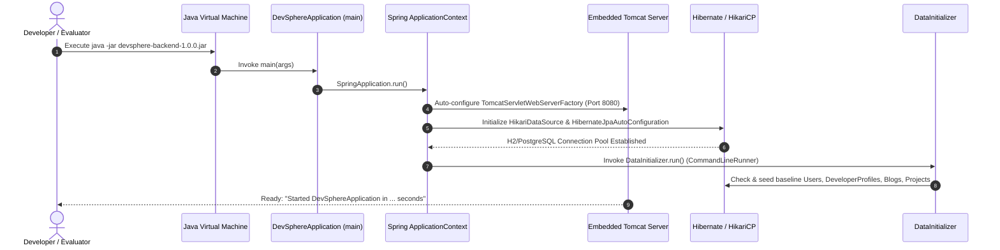
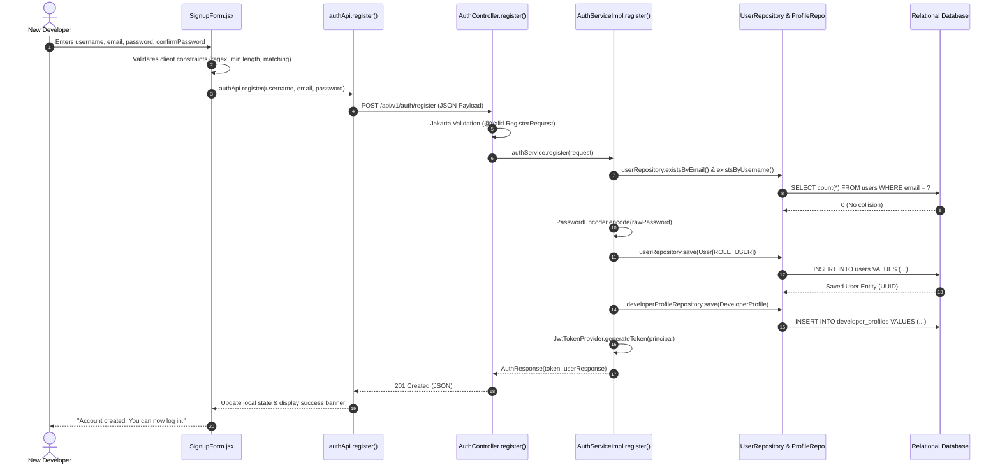
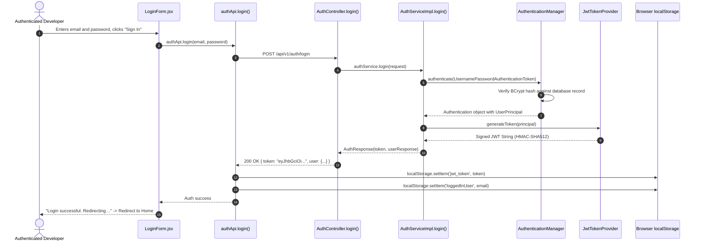
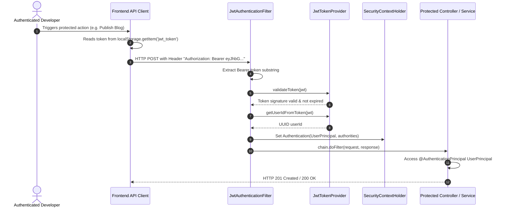
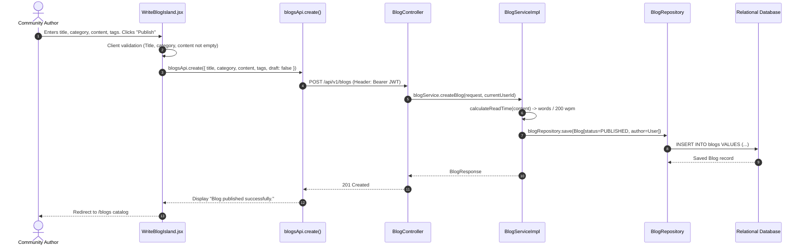
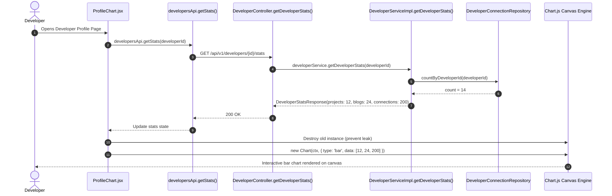

# DevSphere — End-to-End Application Workflows & Sequence Flows

**Course:** FULL STACK WEB DEVELOPMENT (21CSE354T)  
**Activity:** Spring Boot Framework – Part 1  
**Student Name:** AJAYKUMAR N (Reg. No: RA2411003012107)  
**Documentation Focus:** Comprehensive Request Lifecycles from UI to Database

---

## 1. Application Startup & Auto-Configuration Flow

This workflow illustrates how the Spring Boot embedded container initializes, registers security filters, configures data sources, and seeds baseline community records.



### Trace Details
1. **Trigger:** Evaluator launches the fat JAR via command `java -jar target/devsphere-backend-1.0.0.jar`.
2. **Auto-Configuration Engine:** `@SpringBootApplication` activates `TomcatServletWebServerFactory`, configuring Tomcat to bind to port 8080.
3. **Database Detection:** Spring reads `application-dev.properties`, establishing an embedded PostgreSQL-mode H2 database connection at `jdbc:h2:file:./data/devspheredb`.
4. **Data Seeding:** [`DataInitializer.java`](file:///c:/Users/N.AJAYKUMAR/Full%20Stack%20Proojects/backend/src/main/java/com/devsphere/config/DataInitializer.java) runs automatically, verifying that default community developers, published blogs, and sample projects are present in the database.

---

## 2. User Registration & Automated Profile Provisioning Flow

This workflow traces a new developer signing up, verifying field validations, encoding credentials, auto-provisioning a linked developer profile, and receiving a JWT token.



### Flow Breakdown
1. **Starting Page:** `/signup` or `frontend/signup.html`.
2. **User Action:** Fills out fields and clicks "Register".
3. **Frontend Component:** [`SignupForm.jsx`](file:///c:/Users/N.AJAYKUMAR/Full%20Stack%20Proojects/src/islands/SignupForm.jsx).
4. **Client Service:** `authApi.register()` in [`src/services/api.js`](file:///c:/Users/N.AJAYKUMAR/Full%20Stack%20Proojects/src/services/api.js#L61).
5. **HTTP Request:** `POST /api/v1/auth/register`.
6. **Backend Controller:** [`AuthController.java:30`](file:///c:/Users/N.AJAYKUMAR/Full%20Stack%20Proojects/backend/src/main/java/com/devsphere/controller/AuthController.java#L30).
7. **Service Method:** [`AuthServiceImpl.java:57`](file:///c:/Users/N.AJAYKUMAR/Full%20Stack%20Proojects/backend/src/main/java/com/devsphere/service/impl/AuthServiceImpl.java#L57).
8. **Business Rules:**
   - Email format and uniqueness check (`existsByEmail`).
   - Username uniqueness check (`existsByUsername`).
   - Automated provisioning of a `DeveloperProfile` linked to the newly created `User`.
9. **Repositories Affected:** [`UserRepository`](file:///c:/Users/N.AJAYKUMAR/Full%20Stack%20Proojects/backend/src/main/java/com/devsphere/repository/UserRepository.java) and [`DeveloperProfileRepository`](file:///c:/Users/N.AJAYKUMAR/Full%20Stack%20Proojects/backend/src/main/java/com/devsphere/repository/DeveloperProfileRepository.java).
10. **Database Operation:** SQL `INSERT INTO users` followed by SQL `INSERT INTO developer_profiles`.
11. **Backend Response:** HTTP `201 Created` with JWT Bearer token and user details.
12. **Frontend Result:** Renders green success message and clears form inputs.
13. **Failure Scenarios:** `DuplicateResourceException` (`409 Conflict`), `MethodArgumentNotValidException` (`400 Bad Request`).
14. **Relevant Tests:** `AuthControllerTest.register_ValidRequest_Returns201()`, `AuthServiceTest.register_DuplicateEmail_ThrowsException()`.

---

## 3. Authentication & Stateless JWT Token Lifecycle Flow

This workflow illustrates credential verification, cryptographic token creation, client-side storage, and token propagation for subsequent protected operations.



### Flow Breakdown
1. **Starting Page:** `/login` or `frontend/login.html`.
2. **User Action:** Submits credentials.
3. **Frontend Component:** [`LoginForm.jsx`](file:///c:/Users/N.AJAYKUMAR/Full%20Stack%20Proojects/src/islands/LoginForm.jsx).
4. **Client Service:** `authApi.login()` in [`src/services/api.js`](file:///c:/Users/N.AJAYKUMAR/Full%20Stack%20Proojects/src/services/api.js#L73).
5. **HTTP Request:** `POST /api/v1/auth/login`.
6. **Backend Controller:** [`AuthController.java:37`](file:///c:/Users/N.AJAYKUMAR/Full%20Stack%20Proojects/backend/src/main/java/com/devsphere/controller/AuthController.java#L37).
7. **Service Method:** [`AuthServiceImpl.java:97`](file:///c:/Users/N.AJAYKUMAR/Full%20Stack%20Proojects/backend/src/main/java/com/devsphere/service/impl/AuthServiceImpl.java#L97).
8. **Business Rules:** Verifies credentials; rejects deactivated accounts or invalid password combinations.
9. **Security Layer:** `AuthenticationManager` delegates to `CustomUserDetailsService.loadUserByUsername()`, verifying with BCrypt.
10. **Token Issuance:** `JwtTokenProvider` signs the payload using HMAC-SHA512 with claims (`sub`, `id`, `email`, `role`, `iat`, `exp`).
11. **Backend Response:** HTTP `200 OK` with JWT token.
12. **Frontend Result:** Token stored in `localStorage.getItem('jwt_token')`. User redirected to Home.
13. **Failure Scenarios:** Bad credentials throw `UnauthorizedException` (`401 Unauthorized`).
14. **Relevant Tests:** `AuthControllerTest.login_ValidCredentials_Returns200()`, `AuthServiceTest.login_BadCredentials_ThrowsUnauthorizedException()`.

---

## 4. Authenticated Request Authorization & Filter Chain Flow

This workflow illustrates how protected endpoints intercept incoming HTTP requests, extract Bearer tokens, validate digital signatures, establish `SecurityContext`, and enforce role-based access.



### Trace Details
1. **Filter Interception:** Every incoming HTTP request passes through [`JwtAuthenticationFilter.java`](file:///c:/Users/N.AJAYKUMAR/Full%20Stack%20Proojects/backend/src/main/java/com/devsphere/security/JwtAuthenticationFilter.java) before hitting standard controllers.
2. **Signature Verification:** [`JwtTokenProvider.validateToken()`](file:///c:/Users/N.AJAYKUMAR/Full%20Stack%20Proojects/backend/src/main/java/com/devsphere/security/JwtTokenProvider.java) validates the HMAC-SHA512 checksum. If tampered with or expired, `SecurityContext` remains unpopulated.
3. **Principal Resolution:** The user identity is bound to `SecurityContextHolder.getContext().setAuthentication(...)`, making it available to controller methods annotated with `@AuthenticationPrincipal`.

---

## 5. Technical Blog Publishing & Ownership Enforcement Flow

This workflow traces creating a technical article, computing estimated read times, persisting the entity, and enforcing author ownership when editing or deleting.



### Ownership Guard Flow (`PUT /api/v1/blogs/{id}` or `DELETE /api/v1/blogs/{id}`)
1. When an author requests an update or deletion, `BlogServiceImpl.verifyOwnershipOrAdmin()` executes:
   ```java
   if (currentUser.getRole() == Role.ROLE_ADMIN) return;
   if (blog.getAuthor() == null || !blog.getAuthor().getId().equals(currentUserId)) {
       throw new ForbiddenException("You do not have permission to modify or delete this blog post");
   }
   ```
2. **Result:** If a non-author attempts modifications, the server halts execution and returns `403 Forbidden` with an RFC-compliant `ApiError` envelope.
3. **Relevant Tests:** `BlogServiceTest.updateBlog_NonOwner_ThrowsForbiddenException()`, `BlogControllerTest.createBlog_ValidRequest_Returns201()`.

---

## 6. Project Exploration, Filtering, & Idempotent Like Flow

This workflow traces community repository browsing, multi-criteria sorting, and atomic like/unlike operations.

```mermaid
sequenceDiagram
    autonumber
    actor User as Community Member
    participant UI as ProjectsIsland.jsx
    participant API as projectsApi.toggleLike()
    participant Ctrl as ProjectController.toggleLike()
    participant Svc as ProjectServiceImpl.toggleLike()
    participant LikeRepo as ProjectLikeRepository
    participant ProjRepo as ProjectRepository
    participant DB as Relational Database

    User->>UI: Clicks heart icon (♥) on Project Card
    UI->>UI: Optimistically increments like count & turns heart red
    UI->>API: projectsApi.toggleLike(projectId)
    API->>Ctrl: POST /api/v1/projects/{id}/like (Bearer JWT)
    Ctrl->>Svc: projectService.toggleLike(projectId, currentUserId)
    Svc->>LikeRepo: findByProjectIdAndUserId(projectId, currentUserId)
    LikeRepo->>DB: SELECT * FROM project_likes WHERE project_id = ? AND user_id = ?
    alt Like Record Exists (Unlike Action)
        DB-->>LikeRepo: Existing ProjectLike
        Svc->>LikeRepo: delete(like)
        Svc->>ProjRepo: project.setLikes(likes - 1); save(project)
        Svc-->>Ctrl: ProjectResponse(liked=false)
    else No Like Record (Like Action)
        DB-->>LikeRepo: Optional.empty()
        Svc->>LikeRepo: save(new ProjectLike(project, user))
        Svc->>ProjRepo: project.setLikes(likes + 1); save(project)
        Svc-->>Ctrl: ProjectResponse(liked=true)
    end
    Ctrl-->>API: 200 OK ProjectResponse
    API-->>UI: Sync confirmed state with server response
```

### Flow Breakdown
1. **Starting Page:** `/projects` or `frontend/Projects.html`.
2. **User Action:** Clicks the like toggle button.
3. **Frontend Component:** [`ProjectsIsland.jsx:76`](file:///c:/Users/N.AJAYKUMAR/Full%20Stack%20Proojects/src/islands/ProjectsIsland.jsx#L76).
4. **Client Service:** `projectsApi.toggleLike()` in [`src/services/api.js`](file:///c:/Users/N.AJAYKUMAR/Full%20Stack%20Proojects/src/services/api.js#L193).
5. **HTTP Request:** `POST /api/v1/projects/{id}/like`.
6. **Backend Controller:** [`ProjectController.java:67`](file:///c:/Users/N.AJAYKUMAR/Full%20Stack%20Proojects/backend/src/main/java/com/devsphere/controller/ProjectController.java#L67).
7. **Service Method:** [`ProjectServiceImpl.java:127`](file:///c:/Users/N.AJAYKUMAR/Full%20Stack%20Proojects/backend/src/main/java/com/devsphere/service/impl/ProjectServiceImpl.java#L127).
8. **Business Rules:**
   - Atomic toggle prevents double-counting.
   - Like count can never drop below zero (`Math.max(0, likes - 1)`).
9. **Repositories Affected:** [`ProjectLikeRepository`](file:///c:/Users/N.AJAYKUMAR/Full%20Stack%20Proojects/backend/src/main/java/com/devsphere/repository/ProjectLikeRepository.java) and [`ProjectRepository`](file:///c:/Users/N.AJAYKUMAR/Full%20Stack%20Proojects/backend/src/main/java/com/devsphere/repository/ProjectRepository.java).
10. **Database Operation:** SQL `INSERT INTO project_likes` / `DELETE FROM project_likes` and `UPDATE projects SET likes = ...`.
11. **Relevant Tests:** `ProjectServiceTest.toggleLike_WhenNotLiked_LikesProject()`, `ProjectServiceTest.toggleLike_WhenAlreadyLiked_UnlikesProject()`.

---

## 7. Developer Directory & Chart.js Activity Visualization Flow

This workflow illustrates how the developer portfolio retrieves live backend analytics and safely renders Chart.js charts.



### Lifecycle Details
1. **Memory Safety:** When `ProfileChart.jsx` re-renders or unmounts, `chartInstanceRef.current.destroy()` is invoked, ensuring old WebGL / 2D contexts do not cause memory bloat.
2. **Dynamic Data Binding:** Whenever a user clicks `+ Connect`, the backend persists the new peer connection, and the Chart.js visualizer automatically updates its connection bar height in real time.
