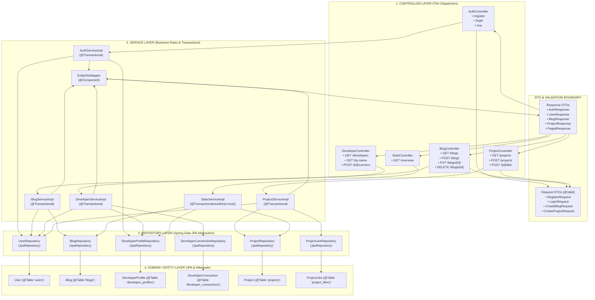
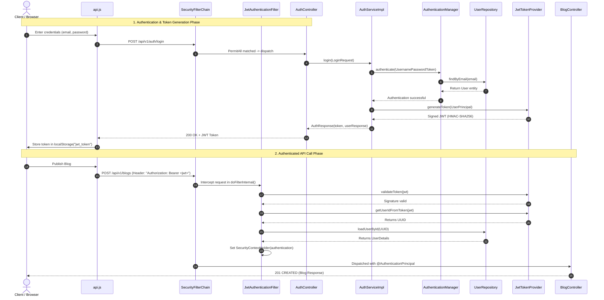
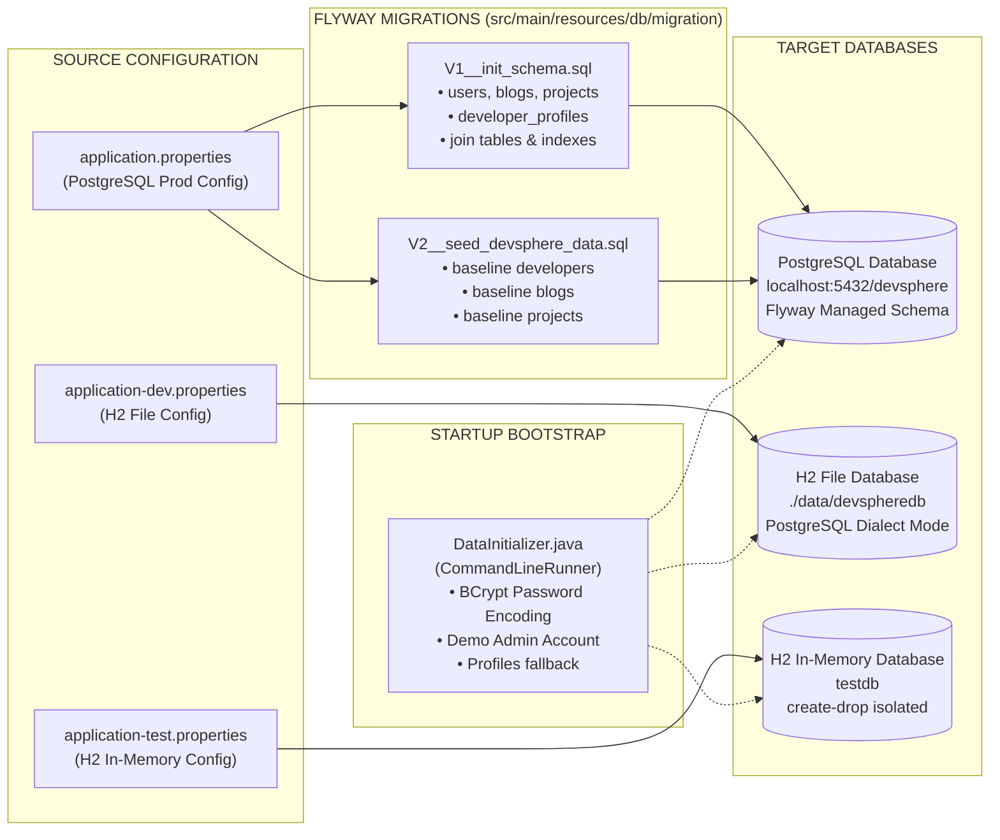

# DevSphere Backend Architecture Audit: Technical Architecture Diagrams

**Document Version:** 1.0.0  
**Audit Target:** DevSphere Spring Boot Backend (`com.devsphere`)  
**Auditor:** Senior Java Backend & Microservices Architect  
**Classification:** Academic & Enterprise Architecture Audit  
**Date:** October 2026  

---

## 1. Diagram 1: High-Level Backend Architecture

This diagram visualizes the overall system architecture, showing the communication boundaries between the client tier, security filtering, Spring Web presentation, business services, data access, and persistence infrastructure.

```mermaid
graph TB
    subgraph ClientTier ["CLIENT TIER (React & Static Web)"]
        UI_React["React Islands & Pages<br/>(SignupForm, LoginForm, BlogIsland, ProjectsIsland)"]
        UI_API["Centralized API Client<br/>(src/services/api.js)"]
        UI_React --> UI_API
    end

    subgraph SecurityBoundary ["SECURITY & FILTER PIPELINE"]
        HTTP_REQ["HTTP / HTTPS Request"]
        CORS_FILTER["CorsFilter<br/>(Allowed: localhost:5173, 3000)"]
        JWT_FILTER["JwtAuthenticationFilter<br/>(OncePerRequestFilter)"]
        AUTH_MGR["AuthenticationManager /<br/>DaoAuthenticationProvider"]
        USER_DETAILS["CustomUserDetailsService"]
        BCRYPT["BCryptPasswordEncoder"]
        
        HTTP_REQ --> CORS_FILTER
        CORS_FILTER --> JWT_FILTER
        JWT_FILTER -.-> USER_DETAILS
        AUTH_MGR --> BCRYPT
        AUTH_MGR --> USER_DETAILS
    end

    subgraph PresentationLayer ["PRESENTATION & REST API BOUNDARY (/api/v1/*)"]
        CTRL_AUTH["AuthController"]
        CTRL_BLOG["BlogController"]
        CTRL_DEV["DeveloperController"]
        CTRL_PROJ["ProjectController"]
        CTRL_STAT["StatsController"]
        
        GLOBAL_EX["GlobalExceptionHandler<br/>(@RestControllerAdvice)"]
        SWAGGER["SpringDoc OpenAPI UI<br/>(/swagger-ui.html)"]
    end

    subgraph BusinessLayer ["BUSINESS LOGIC & SERVICE LAYER (com.devsphere.service)"]
        SVC_AUTH["AuthService / AuthServiceImpl"]
        SVC_BLOG["BlogService / BlogServiceImpl"]
        SVC_DEV["DeveloperService / DeveloperServiceImpl"]
        SVC_PROJ["ProjectService / ProjectServiceImpl"]
        SVC_STAT["StatsService / StatsServiceImpl"]
        
        MAPPER["EntityDtoMapper<br/>(@Component)"]
    end

    subgraph DataAccessLayer ["DATA ACCESS & PERSISTENCE (com.devsphere.repository)"]
        REPO_USER["UserRepository"]
        REPO_DEV["DeveloperProfileRepository"]
        REPO_CONN["DeveloperConnectionRepository"]
        REPO_BLOG["BlogRepository"]
        REPO_PROJ["ProjectRepository"]
        REPO_LIKE["ProjectLikeRepository"]
    end

    subgraph DomainEntities ["DOMAIN ENTITY LAYER (com.devsphere.entity)"]
        ENT_USER["User (@Entity)"]
        ENT_DEV["DeveloperProfile (@Entity)"]
        ENT_CONN["DeveloperConnection (@Entity)"]
        ENT_BLOG["Blog (@Entity)"]
        ENT_PROJ["Project (@Entity)"]
        ENT_LIKE["ProjectLike (@Entity)"]
    end

    subgraph DatabaseTier ["DATABASE ENGINE (Configurable Profiles)"]
        POSTGRES["Production: PostgreSQL 16<br/>(jdbc:postgresql://localhost:5432/devsphere)"]
        H2_DB["Dev / Test: H2 Database<br/>(MODE=PostgreSQL file/mem)"]
        FLYWAY["Flyway Migrations<br/>(V1__init_schema.sql, V2__seed_data.sql)"]
    end

    UI_API --> HTTP_REQ
    JWT_FILTER --> CTRL_AUTH
    JWT_FILTER --> CTRL_BLOG
    JWT_FILTER --> CTRL_DEV
    JWT_FILTER --> CTRL_PROJ
    JWT_FILTER --> CTRL_STAT

    CTRL_AUTH --> SVC_AUTH
    CTRL_BLOG --> SVC_BLOG
    CTRL_DEV --> SVC_DEV
    CTRL_PROJ --> SVC_PROJ
    CTRL_STAT --> SVC_STAT

    SVC_AUTH --> MAPPER
    SVC_BLOG --> MAPPER
    SVC_DEV --> MAPPER
    SVC_PROJ --> MAPPER

    SVC_AUTH --> REPO_USER
    SVC_AUTH --> REPO_DEV
    SVC_BLOG --> REPO_BLOG
    SVC_BLOG --> REPO_USER
    SVC_DEV --> REPO_DEV
    SVC_DEV --> REPO_CONN
    SVC_DEV --> REPO_USER
    SVC_PROJ --> REPO_PROJ
    SVC_PROJ --> REPO_LIKE
    SVC_PROJ --> REPO_USER
    SVC_STAT --> REPO_DEV
    SVC_STAT --> REPO_BLOG
    SVC_STAT --> REPO_PROJ

    REPO_USER --> ENT_USER
    REPO_DEV --> ENT_DEV
    REPO_CONN --> ENT_CONN
    REPO_BLOG --> ENT_BLOG
    REPO_PROJ --> ENT_PROJ
    REPO_LIKE --> ENT_LIKE

    ENT_USER --> POSTGRES
    ENT_DEV --> POSTGRES
    ENT_CONN --> POSTGRES
    ENT_BLOG --> POSTGRES
    ENT_PROJ --> POSTGRES
    ENT_LIKE --> POSTGRES

    FLYWAY -.-> POSTGRES
    FLYWAY -.-> H2_DB
```

---

## 2. Diagram 2: Spring Boot Layered Architecture & Component Matrix

This diagram depicts the strict unidirectional dependency flow across layers, validating the absence of cyclic references and anti-corruption boundaries.

---

## 3. Diagram 3: Authentication and Security Flow

This diagram illustrates the stateless JWT security lifecycle from login through protected resource dispatch.

---

## 4. Diagram 4: Database Interaction and Migration Flow

This diagram maps how entities, schema migrations, and database engines interact across environments.

