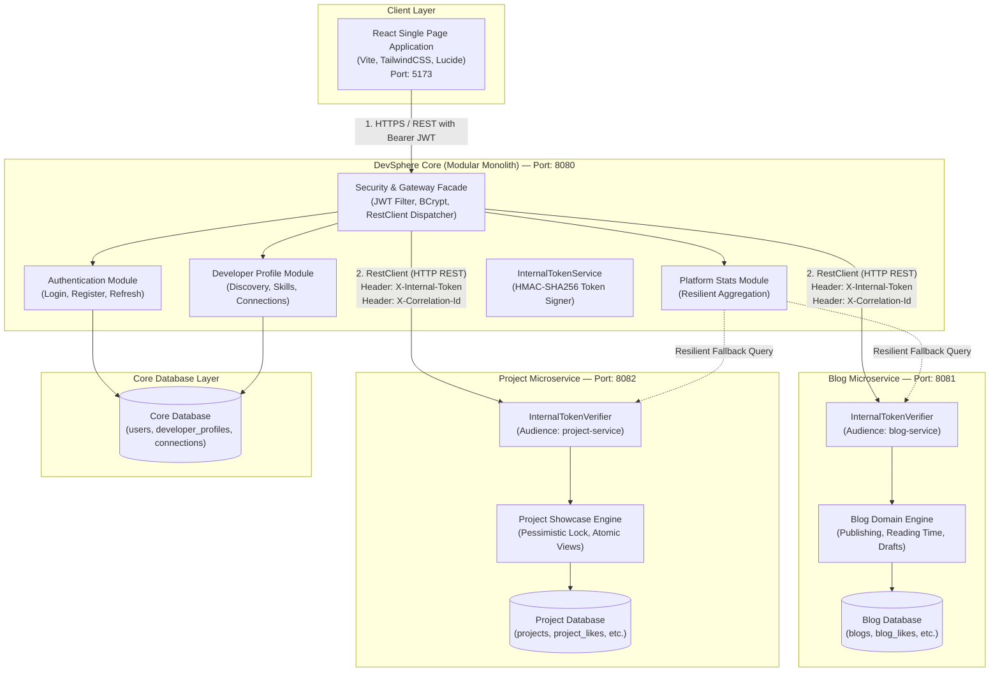
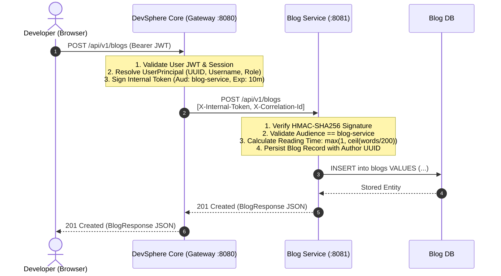
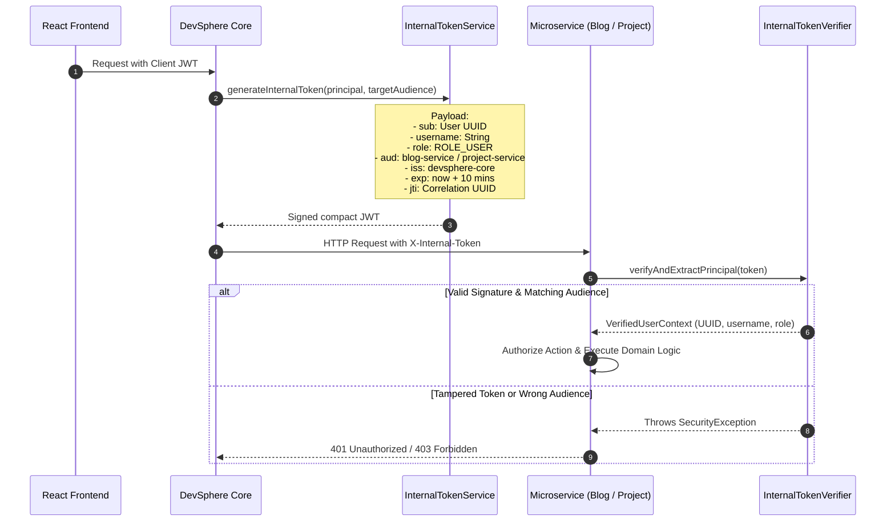
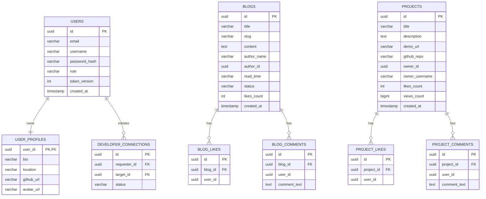
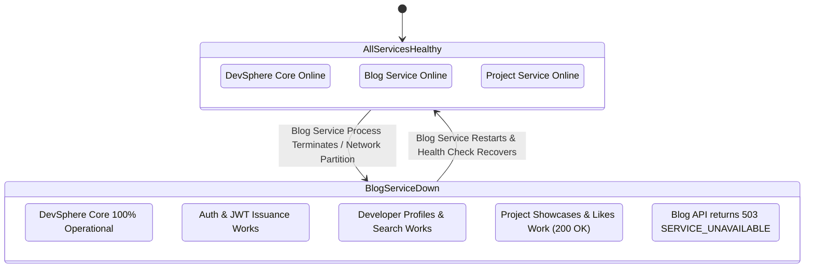

# DevSphere — Master Hybrid Microservices Architecture Diagrams

This document contains comprehensive architectural and sequence diagrams illustrating the DevSphere Hybrid Microservices Architecture.

---

## 1. High-Level System Architecture & Port Registry

The DevSphere platform operates as an integrated **Hybrid Architecture**:
* **DevSphere Core (Modular Monolith)** acts as the **Identity Authority**, **Gateway Facade**, and owner of developer identity, profiles, social connections, and platform aggregation.
* **Blog Service** is an autonomous microservice owning technical blogs, drafts, reading times, tags, bookmarks, and comments.
* **Project Service** is an autonomous microservice owning engineering showcases, atomic likes, atomic views, bookmarks, and comments.

---

## 2. API Gateway Routing & Delegation Sequence

The React frontend maintains a single base URL pointing to `http://localhost:8080/api/v1`. Core delegates write and read operations to downstream microservices, ensuring single source of truth.

---

## 3. Cryptographic Token Propagation & Trust Model

DevSphere employs a zero-trust inter-service security model. Microservices never accept unverified arbitrary headers (such as raw `X-User-Id`). Every internal request carries a cryptographically signed HMAC-SHA256 internal token.

---

## 4. Database Ownership & Schema Boundary Matrix

Each service maintains strict data encapsulation. No cross-service database transactions or foreign keys exist between Core, Blog Service, and Project Service.

---

## 5. Fault Isolation & Graceful Degradation Behavior

When a downstream microservice is down or undergoes maintenance, DevSphere Core isolates the failure and returns a structured `503 SERVICE_UNAVAILABLE` for that specific domain, while all other features continue running seamlessly.

