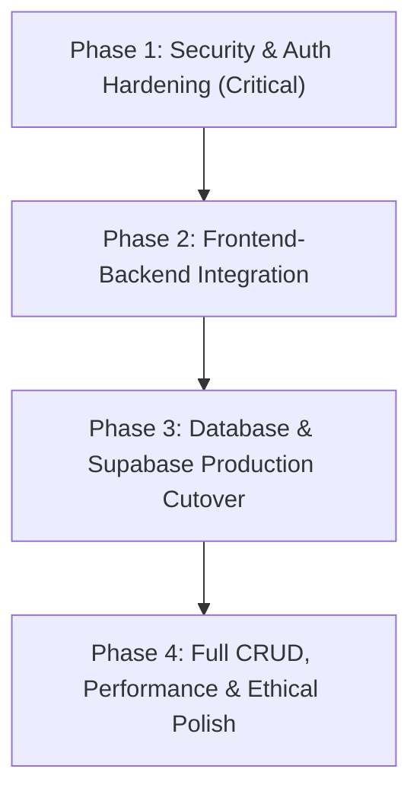

# DevSphere — Target Architecture & Implementation Roadmap

**Document Type:** Target Architecture Evaluation, Service Boundary Definition & Execution Roadmap  
**Date:** 2026-10-31  
**Project:** DevSphere — Developer Community and Portfolio Platform  
**Target Environment:** Spring Boot 3.4.3 / Java 21 / Supabase PostgreSQL / React 18  
**Audit Classification:** READ-ONLY Verification  

---

## 1. Evaluation of Proposed Hybrid Microservices vs Modular Monolith

The previously proposed target architecture envisioned:
- React + Vite frontend on port `5173`.
- Spring Boot Core Backend & API Gateway on port `8080`.
- Developer Service on port `8081`.
- Project Service on port `8082`.
- Blog Service on port `8083`.
- Spring Security + JWT.
- Supabase PostgreSQL (with 4 logical schemas).
- Flyway migrations.
- REST-based internal microservice communication.

### 1.1 Architectural Gap & Reality Check

| Proposed Component | Current Status in Workspace | Evaluation & Technical Reality |
| :--- | :--- | :--- |
| **React + Vite Frontend (5173)** | **VERIFIED / EXISTS** | Operational. Successfully builds (`npm run build`). Requires wiring pages to `api.js`. |
| **Core Monolith (8080)** | **VERIFIED / COMPLETE** | Houses all controllers, services, repositories, security filters, DTOs, and tests. |
| **Developer Service (8081)** | **PROTOTYPE / UNCONNECTED** | Standalone demo with in-memory H2. No security, no gateway integration, no incoming calls. |
| **Project Service (8082)** | **PROTOTYPE / UNCONNECTED** | Standalone demo with in-memory H2. No security, no likes table, no incoming calls. |
| **Blog Service (8083)** | **PROTOTYPE / UNCONNECTED** | Standalone demo with in-memory H2. No security, no draft management, no incoming calls. |
| **API Gateway / Proxy** | **MISSING** | Port 8080 contains zero routing, Spring Cloud Gateway, or reverse proxy logic to ports 8081–8083. |
| **Internal JWT Propagation** | **MISSING** | No microservice validates incoming tokens; no internal mutual TLS or shared HMAC filter exists. |
| **Centralized Database** | **PARTIALLY IMPLEMENTED** | Core uses PostgreSQL/H2 file with Flyway. Microservices use independent in-memory H2 databases. |

---

### 1.2 Microservices vs Modular Monolith Decision Framework

1. **Operational Complexity vs Value:**
   - Deploying 4 separate Spring Boot JVMs requires 4x memory footprint (approx. 1.2GB–2.0GB RAM baseline vs 350MB for one JVM).
   - Introduces distributed failure modes: if Developer Service (8081) is down, Core (8080) must handle circuit breaking, timeouts, and fallbacks.
   - For DevSphere's current scale (developer community with profiles, blogs, and projects), distributed microservices create artificial network hops and serialization latency without organizational or throughput necessity.

2. **Cross-Domain Data Integrity:**
   - A blog has an `author_id` referencing a `user_id`.
   - A project has an `author_id` referencing a `user_id`, and `project_likes` references both `project_id` and `user_id`.
   - A developer connection references `developer_id` and `user_id`.
   - In a distributed microservices model, enforcing referential integrity requires distributed transactions (e.g. Saga pattern) or eventual consistency.
   - In DevSphere Core (`backend/`), all cross-domain relationships are enforced via ACID database constraints.

### 1.3 Architectural Recommendation: Pragmatic Modular Monolith
**We strongly recommend solidifying DevSphere as a high-performance Modular Monolith on port `8080`**, while maintaining clean package decoupling by domain:
- `com.devsphere.modules.auth` (Users, Credentials, JWT)
- `com.devsphere.modules.developer` (Profiles, Skills, Connections, Stats)
- `com.devsphere.modules.project` (Projects, Technologies, Likes, Views)
- `com.devsphere.modules.blog` (Articles, Tags, Drafts, Reading Time)
- `com.devsphere.modules.stats` (Platform Metrics)

If future business growth warrants extracting a specific service (for instance, if project search or image processing demands independent autoscaling), that module can be carved out cleanly using its pre-existing package boundaries.

---

## 2. Target Architecture Diagram

```
                                [React 18 + Vite SPA: Port 5173]
                                              |
                                   (HTTPS / REST / JJWT)
                                              |
                                              v
               +-------------------------------------------------------------+
               |               DEVSphere Core Backend (Port 8080)            |
               |                  Spring Boot 3.4.3 / Java 21                |
               +-------------------------------------------------------------+
               | - Central Security Filter Chain (Spring Security 6)         |
               | - JJWT Token Verification & Version Invalidation             |
               | - Global Exception Handler & Unified API Error Contract      |
               | - Centralized OpenAPI / Swagger Documentation               |
               +-------------------------------------------------------------+
               |                      Modular Domain Core                    |
               |                                                             |
               |  [Auth Module]       [Developer Module]   [Project Module]  |
               |  - Registration       - Profiles           - Showcases      |
               |  - Authentication     - Skills             - Atomic Likes   |
               |  - Token Versioning   - Real Stats         - Atomic Views   |
               |  - BCrypt Hashing     - Connections        - Tech Stacks    |
               |                                                             |
               |  [Blog Module]                     [Stats Module]           |
               |  - Draft Privacy                   - Verified Live Counts   |
               |  - Publishing Lifecycle            - Zero Fake Baselines    |
               |  - Read Time Computation                                    |
               +------------------------------+------------------------------+
                                              |
                                     (HikariCP / JDBC / SSL)
                                              |
                                              v
               +-------------------------------------------------------------+
               |              Supabase Cloud PostgreSQL Database             |
               |                 Managed PostgreSQL 15+                      |
               +-------------------------------------------------------------+
               | Standard Public Schema:                                     |
               | - users                     - developer_profiles            |
               | - developer_skills          - developer_connections         |
               | - projects                  - project_technologies          |
               | - project_likes             - blogs                         |
               | - blog_tags                 - flyway_schema_history         |
               +-------------------------------------------------------------+
```

---

## 3. Preservation of Frontend API Contracts

To guarantee zero regression on the frontend, all existing endpoints exposed by `backend/` must remain **100% backward-compatible**:

| Endpoint | Method | Existing Contract | Proposed Changes |
| :--- | :--- | :--- | :--- |
| `/api/v1/auth/register` | `POST` | `RegisterRequest` -> `AuthResponse` | **Preserve exactly.** Remove client-side plaintext localStorage fallback. |
| `/api/v1/auth/login` | `POST` | `LoginRequest` -> `AuthResponse` | **Preserve exactly.** Enforce strict 401 handling on frontend. |
| `/api/v1/auth/me` | `GET` | Headers -> `UserResponse` | **Preserve exactly.** |
| `/api/v1/developers` | `GET` | `?query=&page=&size=` -> `PagedResponse<DeveloperResponse>` | **Preserve exactly.** Replace N+1 queries with SQL aggregation. |
| `/api/v1/developers/{id}` | `GET` | `id` -> `DeveloperResponse` | **Preserve exactly.** |
| `/api/v1/developers/{id}/stats` | `GET` | `id` -> `DeveloperStatsResponse` | **Preserve contract.** Fix frontend `ProfileChart.jsx` to pass UUID. |
| `/api/v1/developers/me` | `PUT` | `UpdateDeveloperRequest` -> `DeveloperResponse` | **NEW ENDPOINT.** Required to unlock profile editing. |
| `/api/v1/projects` | `GET` | `?category=&search=&sort=&page=&size=` -> `PagedResponse` | **Preserve exactly.** |
| `/api/v1/projects` | `POST` | `CreateProjectRequest` -> `ProjectResponse` | **Preserve contract.** Wire "+ Submit project" button to this API. |
| `/api/v1/projects/{id}/like` | `POST` | `id` -> `ProjectResponse` | **Preserve exactly.** Retain pessimistic locking and count sync. |
| `/api/v1/projects/{id}/view` | `POST` | `id` -> `ProjectResponse` | **Preserve exactly.** Retain atomic SQL increment. |
| `/api/v1/blogs` | `GET` | `?category=&search=&page=&size=` -> `PagedResponse` | **Preserve exactly.** |
| `/api/v1/blogs` | `POST` | `CreateBlogRequest` -> `BlogResponse` | **Preserve contract.** Wire `WriteBlog.jsx` to this API. |
| `/api/v1/blogs/{id}` | `GET` | `id` -> `BlogResponse` | **Update logic.** Check draft privacy (403 if draft and not author). |
| `/api/v1/stats/overview` | `GET` | None -> `OverviewStatsResponse` | **Preserve DTO.** Replace fabricated numbers with genuine database counts. |

---

## 4. Phased Implementation Roadmap



### Phase 1: Security & Authentication Hardening (Critical)
- **Goal:** Close critical authentication bypasses and data leakage risks.
- **Tasks:**
  1. Remove client-side authentication bypass in `src/pages/Login.jsx` (lines 51–59).
  2. Remove plaintext password storage fallback in `src/pages/Signup.jsx` (lines 64–68).
  3. Enforce draft privacy in `BlogServiceImpl.getBlogById` (block non-authors from viewing drafts).
  4. Explicitly protect `/api/v1/blogs/drafts` in `SecurityConfig.java`.
  5. Add startup check requiring `DEVSphere_JWT_SECRET` in non-dev profiles.
- **Deliverables:** Updated `Login.jsx`, `Signup.jsx`, `BlogServiceImpl.java`, `SecurityConfig.java`. Regression tests for draft privacy and unauthorized login.

### Phase 2: Frontend-Backend Integration & Contract Realization
- **Goal:** Connect React SPA pages to the live Spring Boot API client.
- **Tasks:**
  1. Wire `src/pages/Developers.jsx` to `developersApi.getAll()`.
  2. Wire `src/pages/DeveloperProfile.jsx` to `developersApi.getById()` and `developersApi.toggleConnect()`.
  3. Fix `ProfileChart.jsx` to pass `selectedDeveloper.id` (UUID) rather than `dev.name` to `developersApi.getStats()`.
  4. Wire `src/pages/Blogs.jsx` to `blogsApi.getAll()`.
  5. Wire `src/pages/WriteBlog.jsx` to `blogsApi.create()` for both draft saving and publishing.
  6. Fix Navbar username to link to `/developer-profile`.
  7. Correct "Start writing" call-to-action on `Home.jsx` to route to `/write-blog`.
- **Deliverables:** Fully operational React SPA reading and writing live backend data.

### Phase 3: Supabase Cloud PostgreSQL Cutover
- **Goal:** Migrate production database to Supabase PostgreSQL without data corruption.
- **Tasks:**
  1. Review `V1__init_schema.sql` and verify ANSI compliance on Supabase.
  2. Align initial seed script (`V2__seed_devsphere_data.sql`): backfill `project_likes` for initial like counts and associate seeded profiles with valid user IDs.
  3. Validate SSL connectivity (`sslmode=require`) and configure HikariCP pool parameters in `application-prod.properties`.
  4. Execute automated integration and concurrency tests against a staging Supabase instance.
- **Deliverables:** Production Flyway migration verified on Supabase Cloud.

### Phase 4: Full CRUD Completion, Performance & Ethical UX Polish
- **Goal:** Complete missing user features, optimize database queries, and remove dark patterns.
- **Tasks:**
  1. Implement `PUT /api/v1/developers/me` in `DeveloperController` and create profile edit dialog in React.
  2. Implement Project Submission modal on `src/pages/Projects.jsx` calling `projectsApi.create()`.
  3. Optimize developer listing query in `DeveloperServiceImpl` to eliminate N+1 queries.
  4. Remove fabricated metric inflation (+9,994 devs, +2,494 blogs) from `StatsServiceImpl.java` and `About.jsx`.
  5. Archive or retire unused prototype microservices in `microservices/` folder.
- **Deliverables:** Complete, ethical, performant DevSphere platform meeting production standards.

